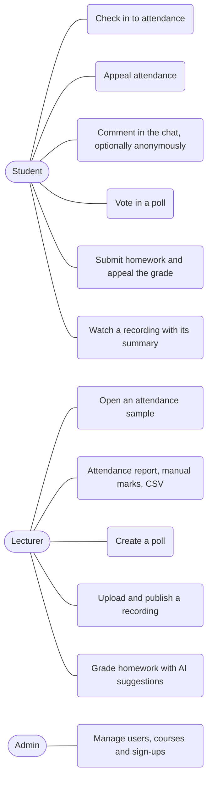

# 4. Main use cases

## Actors
Student, lecturer and admin. External systems: Google (sign-in) and Gemini (AI).

## Client stories
- As a **lecturer**, I want students to mark attendance from their phones in seconds, so that I don't spend lesson time on a roll call.
- As a **lecturer**, I want a spreadsheet of attendance per lesson, so that I can keep records.
- As a **student**, I want to check in with one tap, and to appeal if my phone missed the signal.
- As a **student**, I want to ask or comment during class or after it, anonymously if I choose.
- As a **lecturer**, I want a quick poll on what I just taught.
- As a **lecturer**, I want a summary and chapters for my lesson recording.
- As a **lecturer**, I want suggested grades and feedback that I approve, and a warning about copied work.
- As an **admin**, I want to import the class list and control who can sign in.

## UC-1 Check in to attendance (main)
- **Actor:** student. **Before:** signed in, enrolled in the course, and a sample is open.
- **Main flow:**
  1. The check-in button appears on the course page.
  2. The student taps it and allows the microphone (only the first time).
  3. The phone listens for up to 10 seconds and decodes the code.
  4. The phone sends the code to the server.
  5. The server checks the code and saves the record. The name appears on the projected screen.
- **Other flows:**
  - Wrong or old code: an error message; the student can try again while the sample is open.
  - 5 wrong codes: the student is locked out of this sample.
  - Already checked in, or the sample is closed: an error message.
  - The phone can't decode the signal: the lecturer marks the student by hand (UC-8), or the student appeals (UC-2).
- **After:** one record for this student in this sample.

## UC-7 Open an attendance sample
- **Actor:** lecturer.
- **Main flow:** enter a lesson number and open a sample (a new number starts a new lesson); project the sample screen; press start; the chime and the signal play; the list of names updates live; the sample closes when its time is up.
- **Other flow:** the lesson already has 5 samples, so the sample is refused.

## UC-8 Report and manual marks
- **Actor:** lecturer.
- **Main flow:** open the lesson report (students by samples, with a percentage); mark a student present or cancel a record (manual marks are labeled); answer the open appeals at the top (accept marks the student present, and a reply is optional); export the CSV.

## UC-3, UC-4, UC-9 Chat and polls
- The student writes a message, optionally anonymous, replies and reacts.
- The lecturer creates a poll (anonymous or open). Everyone else votes once and can change the vote, and the results update live.

## UC-10 Recording
- The lecturer uploads a file. Its status moves through uploaded, transcribing, summarizing and ready (or failed, with a retry).
- The lecturer edits the draft and publishes it. Students watch it with chapters, the summary and the transcript.

## UC-11 Grade homework with AI
- The lecturer can add grading notes and a reference solution, then starts the AI check.
- For each submission the lecturer sees a suggested grade, a reason, feedback with deductions, a class note and a copy warning. They approve one or all.
- The lecturer publishes the grades to everyone at once. A student can appeal once.
