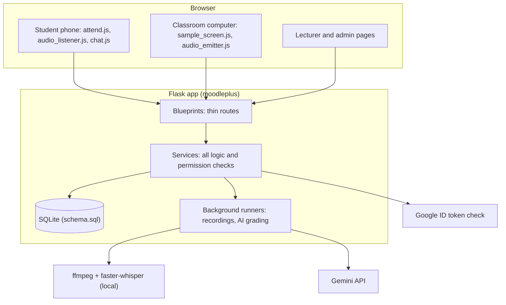

# 5. Main software components

| Component | What it does | Files |
|---|---|---|
| App core | Creates the app, registers the blueprints, reads `.env`, sets the session cookie, handles errors and sign-in state | `__init__.py`, `config.py`, `db.py`, `errors.py`, `security.py` |
| Routes | Read the request, call a service, return a page or JSON. No SQL here | `blueprints/*.py` |
| Users and sign-in | Users, student import, Google token check, sign-up requests | `services/users.py`, `google_auth.py`, `signups.py` |
| Courses and content | Courses, enrollments, course-level permissions, content blocks and files | `services/courses.py`, `content.py` |
| Attendance | Lessons, samples, check-in, manual marks, report and CSV, appeals | `services/attendance.py`, `attendance_appeals.py` |
| Attendance code | Time windows on the server clock, the HMAC code, symbols; playing and decoding the sound | `services/tokens.py`, `static/js/audio_*.js` |
| Chat and polls | Messages, hiding anonymous senders, reactions, read receipts, polls | `services/chat.py`, `polls.py` |
| Recordings | Upload, audio extraction, transcription, summary, lesson feedback, background runner | `services/recordings.py`, `transcription.py`, `llm.py` |
| Assignments and grades | Assignments, submissions, grades, appeals, exams, weighted grades | `services/assignments.py`, `gradebook.py` |
| AI grading | Review of each submission, class comparison, copy check, background runner | `services/ai_grading.py`, `documents.py` |
| Requests | Requests from users to the admins | `services/requests.py` |
| Front end | Templates, JavaScript and CSS; static files are cached and text is sent compressed | `templates/`, `static/`, `web_speed.py` |
| Signal test page | `/debug/audio`: level bars and the decoded code, to check the signal in a room | `blueprints/debug.py` |
