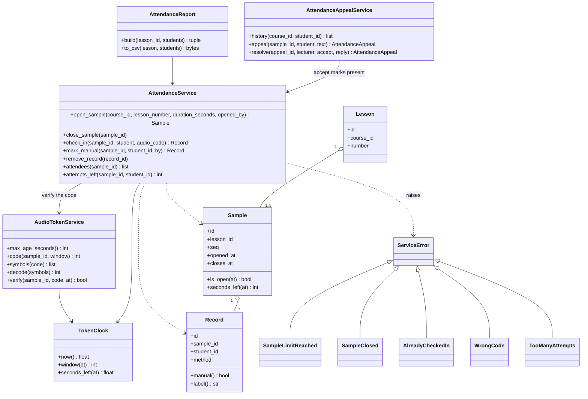
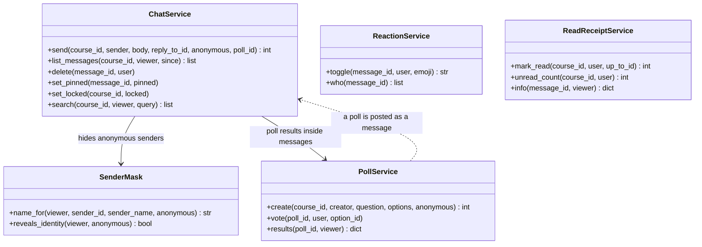
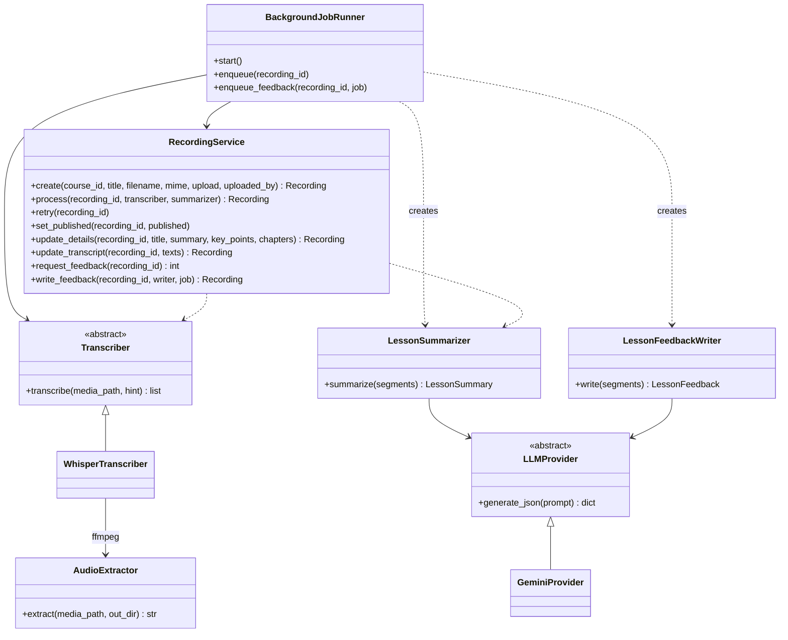
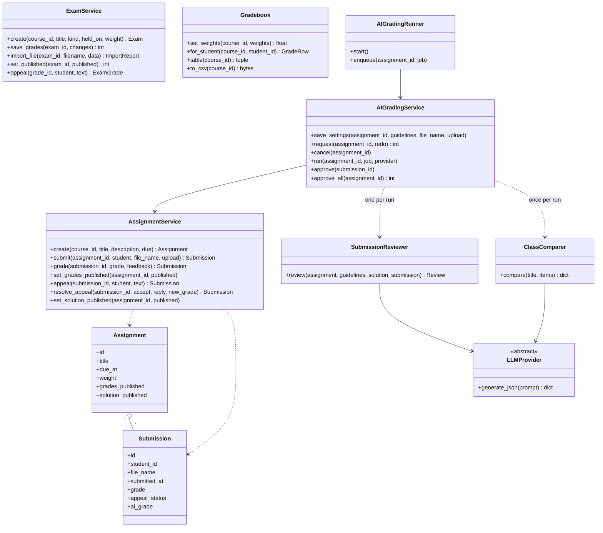
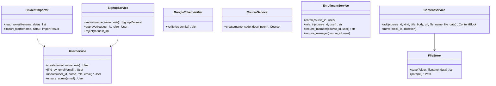
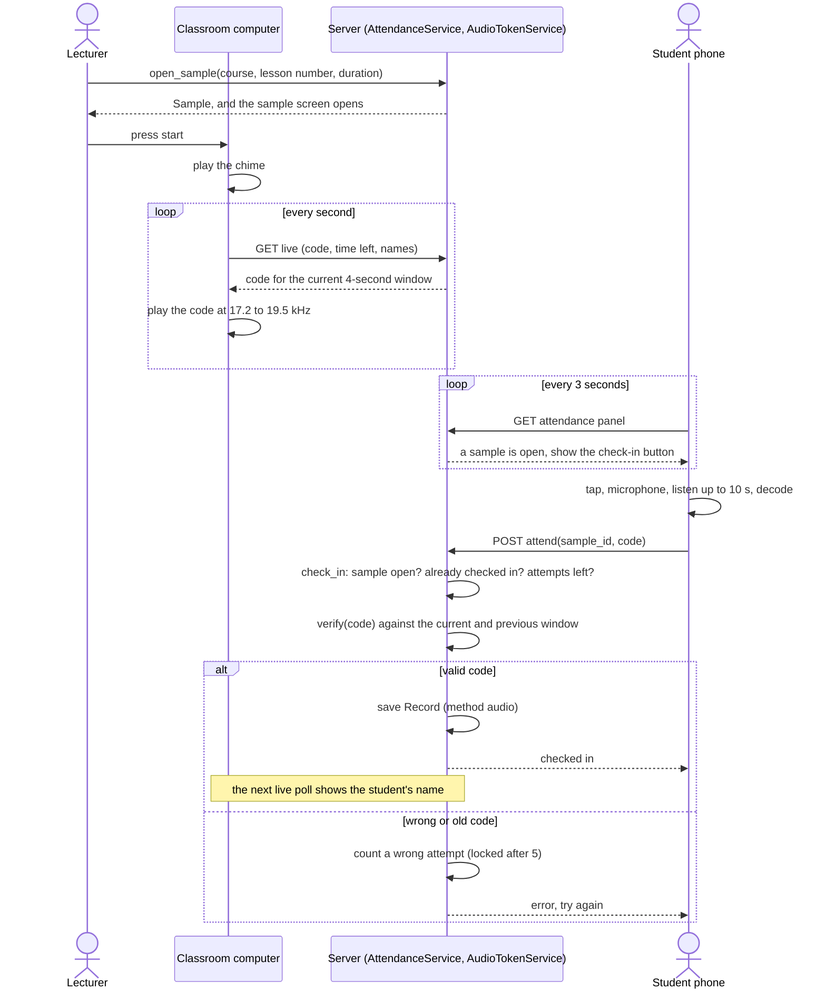
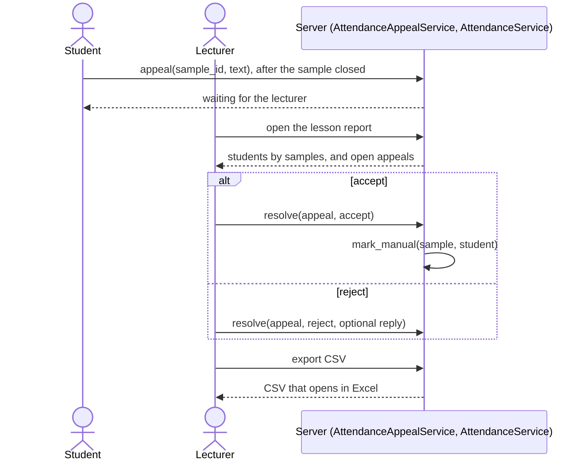
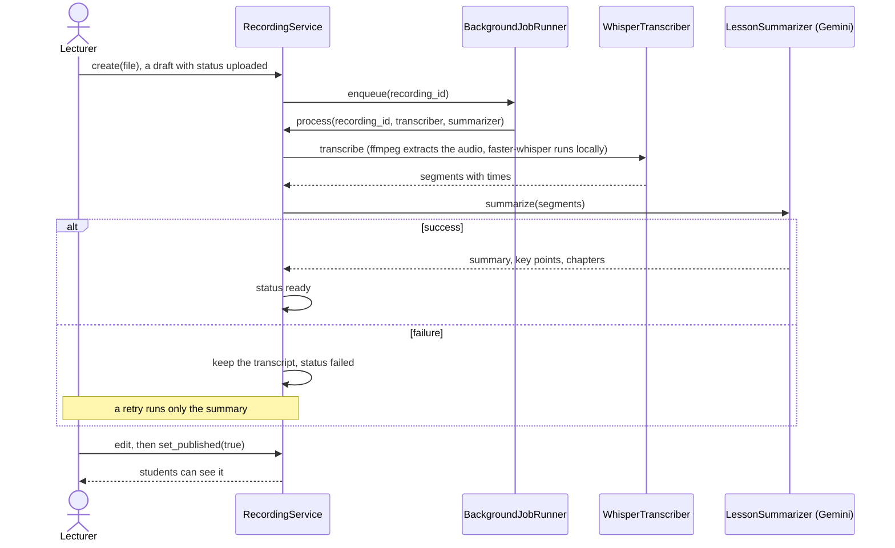
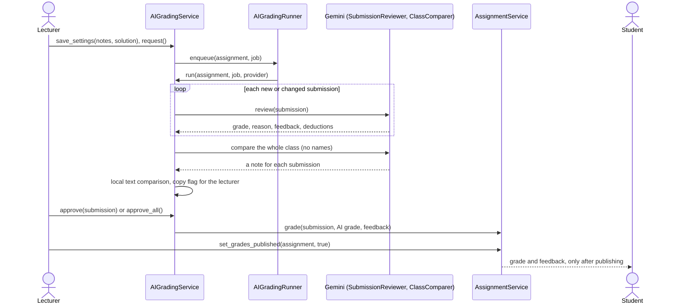
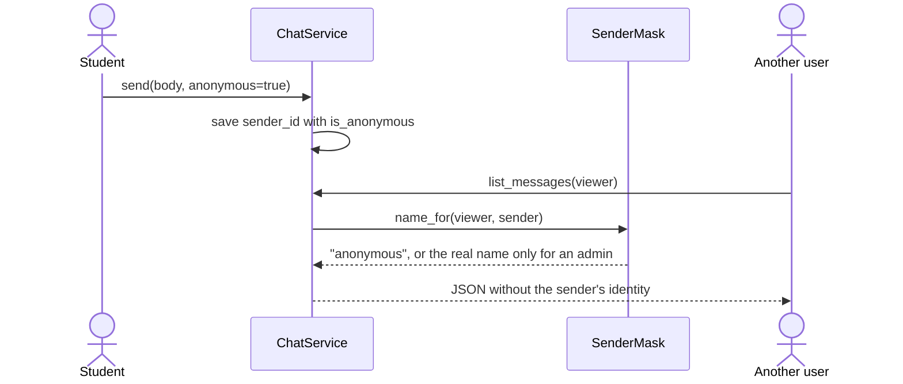

# 6. Class diagrams and sequence diagrams

The classes are in `moodleplus/services/`. Each diagram shows the main public methods; small helpers are left out.

## Class diagrams

### Attendance

### Chat and polls

### Recordings

### Assignments, grades and AI grading

`Gradebook` reads the published assignment and exam grades straight from the database, so it doesn't depend on the other two services.

### Users and courses

## Sequence diagrams

### Attendance check-in (main feature)

### Attendance appeal and report

### Recording: upload to summary

### AI-assisted grading

### Anonymous chat message

